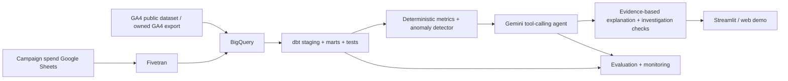

# Architecture · staged build

## Target end-state

**Reality check:** Google BigQuery Sandbox is useful for public GA4 queries, but Fivetran's BigQuery destination does NOT support sandbox accounts. The integrated Fivetran stage therefore needs an eligible BigQuery project, likely with billing enabled, and cost controls. Until then use local synthetic data or independent BigQuery public dataset exploration.

## Stage 1 (implemented)
Synthetic CSV → Python loader & validation → weekday-matched metrics detector → structured JSON → unit tests.

## Future stages (not yet implemented)
- Stage 2: public GA4 dataset exploration; design and implement documented dbt metrics models.
- Stage 3: ingest campaign spend with Fivetran Google Sheets → warehouse and validate lineage.
- Stage 4: create bounded read-only functions (`get_metric`, `compare_periods`, `break_down_by_channel`, `check_data_quality`). Agent uses Gemini function calling over tested outputs.
- Stage 5: interactive demo and human-approved recommendations.
- Stage 6: evaluation, privacy review, CI, video walkthrough, polished GitHub release and publication.

## AI safety and analytical integrity
The LLM must never invent a KPI, use unapproved SQL against production, or silently convert hypotheses into causes. Database tools should be parameterized/read-only, and evaluation should compare the agent's factual numeric claims with query results.
